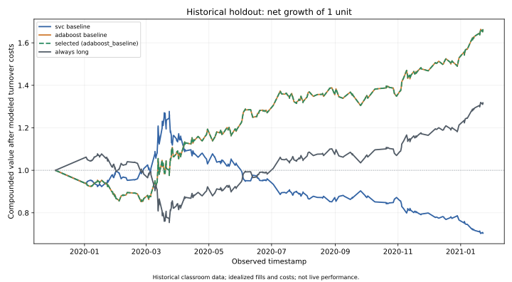

# Machine-Learning Trading Analysis

[](https://github.com/ZekeH43/Module-14-Challenge/actions/workflows/python-checks.yml)

An educational Python project comparing support-vector classification (SVC) and AdaBoost on historical price observations. It demonstrates chronological evaluation, feature engineering, consistent preprocessing, indexed pandas calculations, and regression testing.

The project runs offline from the original CSV. It **does not place trades**. The historical data ends in January 2021, has irregular timestamps, and lacks verified source and adjustment information. Results describe a simplified experiment, not live performance.

**Start with:** the CLI below, the [guided notebook](Starter_Code/machine_learning_trading_bot.ipynb), and the [code walkthrough](docs/WALKTHROUGH.md).

## What the experiment does

1. Read and validate historical closes without filling missing bars.
2. Build moving-average features using only previously observed closes.
3. Fit a scaler and classifier together in a scikit-learn pipeline.
4. Compare four fixed configurations on a validation period, then freeze the choice.
5. Evaluate the chosen configuration and baselines on a later holdout, with matching dates and explicit turnover costs.
6. Export metrics, predictions, charts, and metadata that identify the exact input and settings.



The [evaluation report](reports/example/README.md) explains the measured results, including why the selected model's validation score offers limited evidence of predictive ability. It also identifies a month-long observation gap at the holdout boundary.

## Quick start

Requirements: Git and **Python 3.11 or 3.12**. No API credentials are needed.

```bash
git clone https://github.com/ZekeH43/Module-14-Challenge.git
cd Module-14-Challenge
```

**Windows PowerShell:**

```powershell
py -3.12 -m venv .venv
.venv\Scripts\python -m pip install -r requirements.txt
.venv\Scripts\python -m trading_analysis
```

For the remaining commands, use `.venv\Scripts\python` wherever the instructions say `python`. No PowerShell activation-policy changes are needed.

**WSL, Linux, or macOS:**

```bash
python3.12 -m venv .venv
source .venv/bin/activate
python -m pip install -r requirements.txt
python -m trading_analysis
```

For Python 3.11, substitute `py -3.11` or `python3.11` when creating the environment. Run commands from the repository root.

The default command uses validation starting January 1, 2019, a holdout starting January 1, 2020, seed 42, and **5 basis points per unit of position turnover**. It prints the selected configuration and holdout metrics, then saves results to `artifacts/`.

## Outputs and options

| File | What it contains |
| --- | --- |
| `validation.csv` | All four candidates scored on the same earlier period |
| `holdout.csv` | SVC, AdaBoost, selected configuration, and always-long comparison |
| `*_predictions.csv` | Timestamped positions, actual returns, costs, and compounded values |
| `classification_reports.json` | Per-class precision, recall, F1, and actual support counts |
| `metadata.json` | Source hash, exact date windows, settings, selected candidate, and versions |
| `equity.png`, `equity.svg` | Net compounded values over the common holdout |

```bash
python -m trading_analysis --help
python -m trading_analysis --cost-bps 10 --output artifacts/cost-10bps
python -m trading_analysis --no-plots --output artifacts/tables-only
```

The CLI also accepts `--data`, `--validation-start`, `--test-start`, and `--seed`. See [DATA.md](docs/DATA.md) for the CSV schema. Output files are overwritten on rerun, so use separate folders for comparisons. Once you change settings after seeing holdout results, treat that period as exploratory data rather than a new independent test.

## Run the notebook

```bash
python -m pip install -r requirements-notebook.txt
python -m jupyter lab Starter_Code/machine_learning_trading_bot.ipynb
```

Choose **Restart Kernel and Run All Cells**. The notebook covers input inspection, feature timing, model selection, evaluation, and interpretation. It calls the same package as the CLI. Source notebook outputs are intentionally cleared; the example report provides a quick preview without running Jupyter.

## Understand the comparison

| Candidate | Classifier | Fast/slow SMA windows | Training lookback |
| --- | --- | --- | --- |
| `svc_baseline` | SVC, RBF kernel | 4 / 100 observed bars | 3 calendar months |
| `svc_six_months` | SVC, RBF kernel | 4 / 100 observed bars | 6 calendar months |
| `svc_shorter_smas` | SVC, RBF kernel | 10 / 50 observed bars | 3 calendar months |
| `adaboost_baseline` | AdaBoost, up to 50 decision stumps | 4 / 100 observed bars | 3 calendar months |

The highest **validation balanced accuracy** selects the configuration; candidate order breaks ties. Before the holdout, each comparison model is refit on its trailing training window, then remains fixed. Holdout outcomes never feed back into selection. The always-long benchmark shows what a constant `+1` position produces under the same return and cost convention.

The label is `+1` for a nonnegative next observed return and `-1` for a negative one. A 4-bar window is not four days: the input is irregular intraday data. See [METHOD.md](docs/METHOD.md) for timing, equations, and limitations.

## Code map

| Path | Purpose |
| --- | --- |
| [trading_analysis/data.py](trading_analysis/data.py) | Parse prices, validate timestamps, and build lagged features |
| [trading_analysis/evaluation.py](trading_analysis/evaluation.py) | Train pipelines, align predictions, calculate costs and metrics |
| [trading_analysis/experiment.py](trading_analysis/experiment.py) | Define candidates, select on validation, and evaluate the holdout |
| [trading_analysis/reporting.py](trading_analysis/reporting.py) | Save tables, metadata, and charts |
| [trading_analysis/__main__.py](trading_analysis/__main__.py) | Command-line entry point |
| [tests](tests) | Regression tests for data timing, scaling, alignment, costs, and exports |

## Development checks

```bash
python -m pip install -r requirements-dev.txt
python -m ruff check .
python -m ruff format --check .
python -m pytest -q
python scripts/check_notebook.py
```

GitHub Actions runs the checks and a fresh-kernel notebook execution on Python 3.11 and 3.12. The execution script saves its notebook copy under `artifacts/notebooks/`, leaving the source unchanged.

## What changed from the original assignment

The original [assignment instructions](docs/ORIGINAL_ASSIGNMENT.md) are retained. This refactor corrects SVM prediction on unscaled inputs, reversed classification-report arguments, lost timestamp alignment, and accidental reuse of SVM predictions for the AdaBoost backtest. It completes the model comparison with a reproducible validation/holdout experiment and an always-long benchmark.

The evaluation design deliberately changes: candidates use a common validation year and a later common holdout, rather than selecting settings by repeatedly inspecting one test period. Training uses a lookback before each evaluation boundary, rather than the earliest three months of the dataset. Model selection uses balanced accuracy; returns are reported separately. The old and new outputs therefore are not a like-for-like performance comparison.

Duplicate checkpoints are removed. The original main CSV is unchanged, and a distinct CSV found in a checkpoint folder is preserved under `Starter_Code/Resources/archive/`. See [DATA.md](docs/DATA.md).

For interview preparation, work through [WALKTHROUGH.md](docs/WALKTHROUGH.md) and explain the fixes and assumptions in your own words. The project demonstrates programming and evaluation practices; it does not demonstrate a production trading system.
