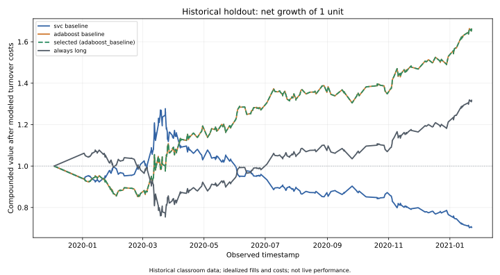

# Default experiment: measured results

This report accompanies the committed [validation table](validation.csv), [holdout table](holdout.csv), [class reports](classification_reports.json), and [metadata](metadata.json). It describes this code run on the historical classroom input, not realized trading performance or expected future returns.

Reproduce it from the repository root:

```bash
python -m trading_analysis --output artifacts/example
```

The committed snapshot includes the summaries, metadata, class reports, and SVG chart. A fresh run also writes every model's per-bar predictions and a PNG chart. Direct dependencies are pinned in `requirements.txt`; small numerical differences across environments remain possible.

## Validation determines the choice

All candidates are scored on 461 shared 2019 observations. The first three-month training windows contain 208 observations; the six-month window contains 426. Configurations and the selection rule are fixed in the code before holdout evaluation.

| Configuration | Validation balanced accuracy | Validation net return |
| --- | ---: | ---: |
| SVC, 4/100 bars, 3 months | 49.44% | +0.53% |
| SVC, 4/100 bars, 6 months | 48.36% | -18.79% |
| SVC, 10/50 bars, 3 months | 49.13% | -3.24% |
| AdaBoost, 4/100 bars, 3 months | **50.89%** | -2.85% |

Increasing the SVC training window did not improve the chosen metric in this experiment. Changing SMA windows also did not improve it. AdaBoost is selected by balanced accuracy, even though the original SVC has the higher validation net return. This illustrates why the selection metric must be stated before reviewing results.

The winning balanced accuracy is only slightly above 0.5. No significance test or repeated-fold stability analysis is supplied, so this is weak evidence for a dependable predictive advantage.

## Later holdout comparison

Models are refit before the holdout and remain fixed while predicting its **639 observed returns**, timestamped January 2, 2020 through January 22, 2021. The selected and AdaBoost-baseline rows are identical because AdaBoost won validation; they are not two independent model improvements.

| Model | Accuracy | Balanced accuracy | Net return | Maximum drawdown |
| --- | ---: | ---: | ---: | ---: |
| SVC baseline | 43.04% | 50.00% | -29.64% | -44.97% |
| AdaBoost / selected | 58.06% | 52.83% | +65.95% | -14.71% |
| Always-long benchmark | 56.96% | 50.00% | +31.63% | -30.01% |

The SVC predicts short throughout this holdout. AdaBoost predicts long about 87.95% of the time, so its results depend substantially on exposure direction and a small set of switches. Its better return here does not establish a general forecasting or trading edge.



## Why the chart needs context

The data has a gap from December 3, 2019 to January 2, 2020. The first scored return spans that entire interval, and the assumed initial fill is at the December close. The three-month holdout training window contains only 50 observations. Missing bars, unverified adjustments, and this small training sample materially limit interpretation.

Costs assume 5 basis points per turnover unit, including entry, reversals, and final exit. Actual spread, latency, borrow fees, taxes, liquidity, and margin constraints are omitted. The model uses an idealized previous-close fill and a simplified constant-exposure calculation. No annualized performance metric or claim of executable profit is made.

The useful portfolio result is the traceable workflow: historical inputs, past-only features, consistent preprocessing, separate selection and evaluation, indexed calculations, and tests for the original bugs. Read [METHOD.md](../../docs/METHOD.md) and [DATA.md](../../docs/DATA.md) for the full assumptions.
